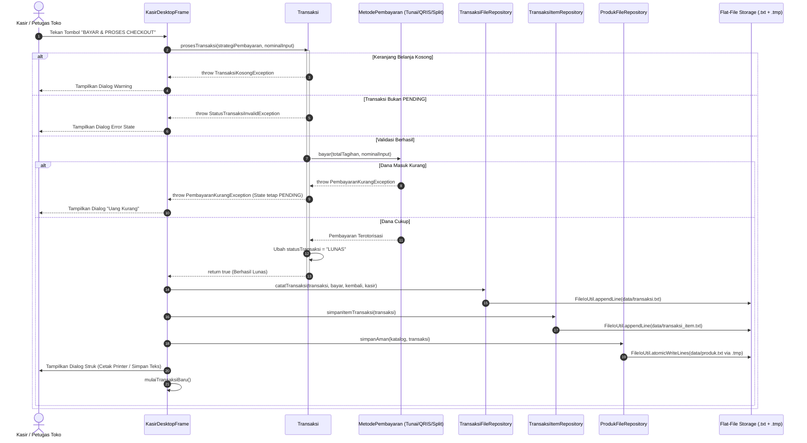

# DOKUMEN OVERVIEW & ANALISIS ARSITEKTUR SISTEM
# SISTEM KASIR SEDERHANA (POINT OF SALE - DESKTOP VERSION)

**Mata Kuliah**    : Praktikum Pemrograman Berorientasi Obyek (PBO)  
**Mahasiswa**      : Rafael Rizky Luga Tanjung (NRP: 3125522007)  
**Dosen Pengampu** : Nirwana Haidar Hari, S.Pd., M.Kom.  
**Program Studi**  : D3/D4 Teknik Informatika - PENS PSDKU Sumenep (2026)  
**Lokasi Direktori**: `P15 POS System Desktop Version 3125522007_Rafael_Rizky/SourceCode`  

---

## 1. Mengenal Sistem: Ini Sistem Apa?

Aplikasi ini adalah **Sistem Kasir Penjualan Retail (Point of Sale / POS System) Berbasis Desktop GUI**. Sistem ini dirancang untuk mendigitalkan dan mengotomatiskan aktivitas kasir toko modern, mencakup:
1. **Pengelolaan Katalog Produk**: Registrasi komoditas majemuk, pembaruan atribut, dan penghapusan data inventaris dengan proteksi integritas stok.
2. **Pencarian Cepat & Input Barcode Keyboard-Wedge**: Penyaringan barang secara instan atau scanning barcode cepat menggunakan scanner fisik / input barcode + Enter langsung masuk keranjang.
3. **Pencatatan Transaksi Penjualan & Pola Strategy Pembayaran**: Keranjang belanja interaktif dengan kalkulasi otomatis subtotal, diskon dinamis kedaluwarsa, diskon member, serta opsi pembayaran multi-metode (**TUNAI**, **QRIS Dinamis [Simulasi]**, dan **SPLIT PAYMENT**).
4. **Validasi & Penegakan Aturan Bisnis (*Fail-Fast*)**: Penolakan otomatis atas kondisi transaksi abnormal (stok habis, pembayaran kurang, nota kosong, barang kedaluwarsa, akses non-admin) menggunakan checked exception terstruktur.
5. **Pencetakan Struk Digital & Fisik**: Penampil nota transaksi kasir lengkap dengan fitur kirim langsung ke printer via `java.awt.print` dan ekspor berkas struk teks (`data/struk_<id>.txt`).
6. **Otentikasi Multi-Role Kasir vs Admin**: Pemisahan hak akses kasir dan administrator dengan penyimpanan kredensial hash SHA-256 dan salt acak 16 bytes.
7. **Audit Log Transaksi Granular & Laporan Harian**: Pencatatan riwayat nota 9 kolom (`data/transaksi.txt`), rincian baris item transaksi (`data/transaksi_item.txt`), agregasi omzet harian & top 5 produk terlaris, serta fitur VOID nota lunas berotorisasi admin dengan pemulihan stok otomatis.
8. **Keandalan Crash-Safe Atomic Write & Auto-Backup**: Operasi penyimpanan berkas aman via temporary `.tmp` + `ATOMIC_MOVE` fallback, serta pencadangan otomatis berstempel waktu dengan batas rotasi 5 file cadangan.

Sistem ini merupakan **kulminasi proyek terintegrasi dari Modul 1 hingga Modul 15** yang mendemonstrasikan implementasi pilar-pilar OOP (*Encapsulation, Inheritance, Polymorphism, Abstraction*), manajemen koleksi memori, penanganan eksepsi, *file I/O*, serta perancangan GUI berbasis *event-driven programming* dengan Java Swing tanpa ketergantungan pustaka eksternal (*zero external dependency*).

---

## 2. Struktur Direktori & Pemetaan Berkas

```
SourceCode/
├── MainDesktop.java                   <-- Bootstrap / Entry Point Peluncur Aplikasi GUI
├── view/
│   └── KasirDesktopFrame.java         <-- Lapisan Presentasi (Java Swing GUI & Event Controller)
├── model/
│   ├── Role.java                      <-- Enum Hak Akses (KASIR, ADMIN)
│   ├── User.java                      <-- Entity Akun Pengguna Terotentikasi
│   ├── AuthService.java               <-- Layanan Otentikasi & Hashing SHA-256 + Salt
│   ├── FileIoUtil.java                <-- Utility Crash-Safe Atomic Write & Auto-Backup
│   ├── Produk.java                    <-- Abstract Superclass Domain Komoditas (Ambang Stok = 5)
│   ├── ProdukMakanan.java             <-- Subclass Komoditas Konsumsi (LocalDate & Diskon Kedaluwarsa)
│   ├── ProdukElektronik.java          <-- Subclass Komoditas Hardware (Info Garansi Bulan)
│   ├── DapatDidiskon.java             <-- Interface Kontrak Diskon Promosi Item
│   ├── Pelanggan.java                 <-- Entity Data Konsumen & Skema Diskon Member
│   ├── ItemTransaksi.java             <-- Komposisi Baris Belanjaan (Snapshot Nama, Harga, Qty)
│   ├── Transaksi.java                 <-- Aggregate Root Nota Transaksi & Pelunasan Multi-Strategy
│   ├── MetodePembayaran.java          <-- Interface Pola Strategy Pembayaran
│   ├── PembayaranTunai.java           <-- Concrete Strategy: Pembayaran Uang Fisik & Kembalian
│   ├── PembayaranQrisSimulasi.java    <-- Concrete Strategy: QRIS Dinamis Simulasi (Kembalian 0)
│   ├── SplitPayment.java              <-- Concrete Strategy: Kombinasi Pembayaran Tunai + QRIS
│   ├── KatalogProduk.java             <-- Collection Manager In-Memory (List<Produk>)
│   ├── ProdukFileRepository.java      <-- I/O Persistence Katalog Crash-Safe (data/produk.txt)
│   ├── TransaksiFileRepository.java   <-- I/O Log Transaksi & Operasi VOID (data/transaksi.txt)
│   ├── TransaksiItemRepository.java   <-- I/O Rincian Item Nota (data/transaksi_item.txt)
│   ├── LaporanPenjualan.java          <-- Agregasi Finansial Harian & Top 5 Produk Terlaris
│   └── exception/
│       ├── KasirException.java        <-- Superclass Checked Exception Domain Kasir
│       ├── StokTidakCukupException.java          <-- Ditolak jika qty > stok fisik
│       ├── PembayaranKurangException.java        <-- Ditolak jika dana < tagihan
│       ├── TransaksiKosongException.java         <-- Ditolak jika checkout nota kosong
│       ├── StatusTransaksiInvalidException.java  <-- Ditolak jika nota LUNAS/BATAL dimutasi / VOID ganda
│       ├── ProdukSedangDigunakanException.java   <-- Ditolak jika produk di keranjang dihapus
│       ├── AksesDitolakException.java            <-- Ditolak jika non-admin akses fitur admin
│       ├── OtentikasiException.java              <-- Ditolak jika login/registrasi gagal
│       ├── TransaksiTidakDitemukanException.java <-- Ditolak jika nota VOID tidak ditemukan
│       └── ProdukKadaluarsaException.java        <-- Ditolak jika barang expired dimasukkan keranjang
├── data/
│   ├── produk.txt                     <-- Berkas Fisik Katalog Barang
│   ├── transaksi.txt                  <-- Berkas Fisik Log Transaksi (9 Kolom)
│   ├── transaksi_item.txt             <-- Berkas Fisik Rincian Item Transaksi
│   ├── users.txt                      <-- Berkas Fisik Kredensial Pengguna (Hash+Salt)
│   └── backup/                        <-- Subdirektori Rotasi Cadangan Otomatis Berstempel Waktu
└── test/
    ├── RunAllTests.java               <-- Runner Suite Terpadu (14 Uji Otomatis 100% Pass)
    ├── TestOrderLineImmutability.java
    ├── TestEditStokKeranjang.java
    ├── TestStokTereservasiSimpanFile.java
    ├── TestInvarianceUbahProduk.java
    ├── TestAlurStokResetTransaksi.java
    ├── TestCheckoutVsSafeSave.java
    ├── TestHapusProdukKeranjangDanWindowClosing.java
    ├── TestBatalTidakTulisTransaksiFile.java
    ├── TestAuthAndRoles.java
    ├── TestItemLogAndDailyReport.java
    ├── TestVoidTransaction.java
    ├── TestDiskonKadaluarsaDanStok.java
    ├── TestStrategyPembayaran.java
    └── TestCrashSafeAtomicWrite.java
```

---

## 3. Diagram Arsitektur Kelas (UML Class Diagram)

Diagram berikut merefleksikan seluruh method dan relasi objek **sesuai dengan implementasi kode aktual**:

```mermaid
classDiagram
    direction TB

    class MainDesktop {
        +main(args: String[])
    }

    class KasirDesktopFrame {
        -katalog: KatalogProduk
        -produkRepo: ProdukFileRepository
        -transaksiRepo: TransaksiFileRepository
        -transaksiItemRepo: TransaksiItemRepository
        -authService: AuthService
        -currentUser: User
        -transaksiAktif: Transaksi
        -modelKatalog: DefaultTableModel
        -modelKeranjang: DefaultTableModel
        -txtBarcodeScan: JTextField
        -cmbMetodeBayar: JComboBox
        +simpanKatalogAmanKeFile(path: Path)
        -muatTabelKatalog()
        -filterKatalog(kw: String)
        -muatTabelKeranjang()
        -mulaiTransaksiBaru()
        -aksiScanBarcodeEnter()
        -aksiTambahKeKeranjang()
        -aksiBatalkanItemKeranjang()
        -aksiBukaDialogProdukBaru()
        -aksiBukaDialogEditProduk()
        -aksiHapusProdukKatalog()
        -aksiSimpanKatalogFile()
        -aksiProsesPembayaran()
        -tampilkanDialogStruk(trx, bayar, kembali, metode)
        -aksiBukaLaporanHarian()
        -aksiBukaRiwayatVoid()
        -updateModePembayaran()
        -hitungKembalianLive()
    }

    class KatalogProduk {
        -daftarProduk: List~Produk~
        +tambahProduk(produk: Produk)
        +cariProduk(kode: String): Produk
        +cariProdukByNama(keyword: String): List~Produk~
        +ubahProduk(kode, namaBaru, hargaBaru, stokBaru, extraBaru): boolean
        +hapusProduk(kode: String): boolean
        +hapusProduk(kode: String, transaksiAktif: Transaksi): boolean
        +gantiSemuaProduk(produkBaru: List~Produk~)
        +kosongkanKatalog()
        +tampilkanKatalog()
        +hitungTotalNilaiInventaris(): long
        +getJumlahProduk(): int
        +isKosong(): boolean
        +getDaftarProdukReadOnly(): List~Produk~
        +buatSnapshotStokAman(transaksi: Transaksi): KatalogProduk
    }

    class Produk {
        <<abstract>>
        -kode: String
        -nama: String
        -harga: int
        -stok: int
        +AMBANG_STOK_MENIPIS: int = 5
        +getKode(): String
        +getNama(): String
        +getHarga(): int
        +getStok(): int
        +isStokMenipis(): boolean
        +ubahNama(namaBaru: String)
        +ubahHarga(hargaBaru: int)
        +ubahStok(stokBaru: int)
        +tambahStok(jumlah: int)
        +kurangiStok(jumlah: int)
        +cekKetersediaan(jumlah: int): boolean
        +hitungNilaiInventaris(): int
        +tampilkanData()
        +getKategoriInfo()* String
        +tampilkanDetailKhusus()* void
    }

    class DapatDidiskon {
        <<interface>>
        +getHarga()* int
        +hitungDiskon(persentase: double) double
        +getHargaSetelahDiskon(persentase: double) double
    }

    class ProdukMakanan {
        -tanggalKadaluarsaDate: LocalDate
        +getTanggalKadaluarsa(): String
        +getTanggalKadaluarsaDate(): LocalDate
        +ubahTanggalKadaluarsa(tanggalBaru: String)
        +hitungSisaHari(clock: Clock): long
        +isKadaluarsa(clock: Clock): boolean
        +hitungDiskonKedaluwarsa(clock: Clock): double
        +getKategoriInfo(): String
        +tampilkanDetailKhusus(): void
    }

    class ProdukElektronik {
        -garansiBulan: int
        +getGaransiBulan(): int
        +ubahGaransiBulan(garansiBaru: int)
        +getKategoriInfo(): String
        +tampilkanDetailKhusus(): void
    }

    class Pelanggan {
        -idPelanggan: String
        -nama: String
        -nomorHP: String
        -tipeMember: String
        +getIdPelanggan(): String
        +getNama(): String
        +getNomorHP(): String
        +getTipeMember(): String
        +getDiskon(): double
        +ubahNama(namaBaru: String)
        +ubahNomorHP(nomorBaru: String)
        +ubahTipeMember(memberBaru: String)
        +hitungPotonganMember(totalBelanja: double): double
        +tampilkanData()
    }

    class ItemTransaksi {
        -produk: Produk
        -jumlahBeli: int
        -diskonItem: double
        -hargaSatuan: int
        -namaProduk: String
        +getProduk(): Produk
        +getJumlahBeli(): int
        +getDiskonItem(): double
        +getHargaSatuan(): int
        +getNamaProduk(): String
        +ubahJumlahBeli(jumlahBaru: int)
        +ubahDiskonItem(diskonBaru: double)
        +hitungSubtotalGross(): int
        +hitungNominalDiskonItem(): double
        +hitungSubtotal(): int
        +tampilkanItem()
    }

    class Transaksi {
        -idTransaksi: String
        -tanggal: String
        -pelanggan: Pelanggan
        -daftarItem: ArrayList~ItemTransaksi~
        -statusTransaksi: String
        -metodePembayaranTerpilih: MetodePembayaran
        +getIdTransaksi(): String
        +getTanggal(): String
        +getPelanggan(): Pelanggan
        +getDaftarItem(): List~ItemTransaksi~
        +getStatusTransaksi(): String
        +getMetodePembayaranTerpilih(): MetodePembayaran
        +tambahItem(produk: Produk, jumlahBeli: int)
        +tambahItem(produk: Produk, jumlahBeli: int, clock: Clock)
        +tambahItem(produk: Produk, jumlahBeli: int, diskonPromosi: double)
        +batalkanItem(index: int)
        +batalkanTransaksi()
        +adaProdukAktif(kodeProduk: String): boolean
        +getKuantitasItemAktif(kodeProduk: String): int
        +getReservasiStokMap(): Map~String, Integer~
        +hitungTotalSubtotal(): int
        +hitungDiskonNominal(): double
        +hitungTotalBayar(): double
        +prosesTransaksi(uangDiterima: double): boolean
        +prosesTransaksi(metode: MetodePembayaran, nominal: double): boolean
        +generateTeksStruk(): String
    }

    class MetodePembayaran {
        <<interface>>
        +getNamaMetode()* String
        +bayar(tagihan: double, nominalMasuk: double)* void
        +getKembalian()* double
        +getInformasiTransaksi()* String
    }

    class PembayaranTunai {
        -uangDiterima: double
        -kembalian: double
    }

    class PembayaranQrisSimulasi {
        -kodeNmid: String
        -nominalDibayar: double
    }

    class SplitPayment {
        -nominalTunai: double
        -nominalQris: double
        -kembalian: double
    }

    class FileIoUtil {
        <<utility>>
        +MAX_BACKUP_ROTASI: int = 5
        +atomicWriteLines(targetFile: Path, lines: List~String~)
        +appendLine(targetFile: Path, line: String)
        +buatBackupDanRotasi(targetFile: Path, maxRotasi: int)
    }

    class ProdukFileRepository {
        +simpan(path: Path, katalog: KatalogProduk)
        +simpanAman(path: Path, katalog: KatalogProduk, transaksi: Transaksi)
        +muat(path: Path, katalog: KatalogProduk)
    }

    class TransaksiFileRepository {
        +catatTransaksi(path, transaksi, bayar, kembali, kasir)
        +voidTransaksi(pathTrx, pathItem, idTrx, adminUser, katalog, itemRepo)
        +muatSemuaTransaksi(path): List~String[]~
    }

    class TransaksiItemRepository {
        +simpanItemTransaksi(path, transaksi)
        +muatItemByTransaksi(path, idTransaksi): List~String[]~
        +muatSemuaItem(path): List~String[]~
    }

    class LaporanPenjualan {
        +buatLaporanHarian(pathTrx, pathItem, tanggalFilter): LaporanPenjualan
        +hitungTotalOmzet(): double
        +hitungTotalNotaLunas(): int
        +getTop5ProdukTerlaris(): List~ItemTerlaris~
    }

    class Role {
        <<enumeration>>
        KASIR
        ADMIN
    }

    class User {
        -username: String
        -saltHex: String
        -hashHex: String
        -role: Role
        +getUsername(): String
        +getSaltHex(): String
        +getHashHex(): String
        +getRole(): Role
    }

    class AuthService {
        -userFilePath: Path
        +login(username, password): User
        +register(username, password, role): User
        +enforceAdmin(user, operasi)
    }

    %% Hierarki Pewarisan & Implementasi
    Produk <|-- ProdukMakanan
    Produk <|-- ProdukElektronik
    DapatDidiskon <|.. ProdukMakanan
    DapatDidiskon <|.. ProdukElektronik
    MetodePembayaran <|.. PembayaranTunai
    MetodePembayaran <|.. PembayaranQrisSimulasi
    MetodePembayaran <|.. SplitPayment

    %% Hubungan Asosiasi, Agregasi, dan Komposisi
    Transaksi *-- ItemTransaksi : Komposisi (*--)
    ItemTransaksi o-- Produk : Agregasi (o--)
    Transaksi --> Pelanggan : Asosiasi (-->)
    Transaksi --> MetodePembayaran : Pola Strategy (-->)
    KatalogProduk o-- Produk : Agregasi (o--)
    KasirDesktopFrame --> KatalogProduk
    KasirDesktopFrame --> ProdukFileRepository
    KasirDesktopFrame --> TransaksiFileRepository
    KasirDesktopFrame --> TransaksiItemRepository
    KasirDesktopFrame --> AuthService
    KasirDesktopFrame --> Transaksi
    ProdukFileRepository ..> FileIoUtil : Safe Atomic Write
    TransaksiFileRepository ..> FileIoUtil : Safe Atomic Write
```



---

## 4. Diagram Alur Checkout & Pembayaran Kasir (Sequence Diagram)

Berikut alur interaksi checkout menggunakan pola **Strategy** dan persistensi multi-file:



---

## 5. Hierarki Penanganan Eksepsi Kasir (Checked Exception)

```
java.lang.Throwable
└── java.lang.Exception
    └── model.exception.KasirException (Checked Abstract Superclass)
        ├── StokTidakCukupException          (Kode: ERR-STOK-INSUFFICIENT)
        ├── PembayaranKurangException        (Kode: ERR-PAY-INSUFFICIENT)
        ├── TransaksiKosongException         (Kode: ERR-CART-EMPTY)
        ├── StatusTransaksiInvalidException  (Kode: ERR-STATE-INVALID)
        ├── ProdukSedangDigunakanException   (Kode: ERR-PROD-IN-CART)
        ├── AksesDitolakException            (Kode: ERR-ACCESS-DENIED)
        ├── OtentikasiException              (Kode: ERR-AUTH-FAIL)
        ├── TransaksiTidakDitemukanException (Kode: ERR-TRX-NOT-FOUND)
        └── ProdukKadaluarsaException        (Kode: ERR-PROD-EXPIRED)
```

---

## 6. Format Data Berkas Fisik & Bukti Backward Compatibility

### A. Berkas `data/produk.txt` (Katalog Barang)
Format Kolom: `KODE|NAMA|HARGA|STOK|KATEGORI|EXTRA_ATTRIBUTES`
Contoh baris data:
```text
MK01|Roti Bakar Keju|15000|25|Makanan|2026-12-31
MK02|Susu UHT Coklat 250ml|8500|40|Makanan|2026-10-15
EL01|Mouse Wireless Silent|125000|15|Elektronik|12
EL02|Keyboard Mechanical RGB|350000|8|Elektronik|24
```

### B. Berkas `data/transaksi.txt` (Log Transaksi Penjualan)
Format Kolom (Fase 1-3): `ID_TRX|TANGGAL|NAMA_PELANGGAN|TIPE_MEMBER|TOTAL_BAYAR|NOMINAL_BAYAR|KEMBALIAN|STATUS|KASIR`
- Format Baru: 9 Kolom dengan nama kasir di akhir.
- Backward Compatibility: Format lama 8 kolom otomatis dibaca dan diberi default `KASIR = "system"`.
Contoh baris data:
```text
TRX-1794207600000|09-11-2026 14:00|Budi Santoso|VIP|121125|150000|28875|LUNAS|admin
TRX-1794207600001|09-11-2026 14:15|Umum|REGULER|50000|50000|0|VOID|budi_kasir
```

### C. Berkas `data/transaksi_item.txt` (Log Item Tiap Nota)
Struktur Kolom: `ID_TRANSAKSI|KODE_PRODUK|NAMA_PRODUK|HARGA_SATUAN|QTY|DISKON_ITEM|SUBTOTAL`
Menyimpan snapshot nama dan harga saat checkout sehingga kebal terhadap mutasi katalog di masa depan.

### D. Berkas `data/users.txt` (Kredensial Pengguna Multi-Role)
Struktur Kolom: `USERNAME|SALT_HEX|HASH_HEX|ROLE`
- Salt: 16 bytes acak via `SecureRandom` JDK (32 karakter heksadesimal).
- Hash: SHA-256 digest dari `(salt + password)` via `MessageDigest` JDK (64 karakter heksadesimal).
- Role: `ADMIN` atau `KASIR`.

---

## 7. Status Implementasi & Evaluasi Kritis Arsitektur

### A. Fitur yang SUDAH Diimplementasikan & Teruji (Disertai Bukti 14 Uji Otomatis)
1. **CRUD Katalog In-Memory**: Tambah, Cari (kode & nama), Edit (dialog modal pre-filled), dan Hapus produk.
2. **Order Line Immutability (Snapshot Harga Keranjang)**: Setiap `ItemTransaksi` merekam `hargaSatuan` dan `namaProduk` saat dimasukkan ke keranjang belanja (teruji di `TestOrderLineImmutability`).
3. **Atomic Pre-Validation pada `ubahProduk`**: Validasi seluruh parameter tuntas sebelum setter pertama dieksekusi (teruji di `TestInvarianceUbahProduk`).
4. **Proteksi Integritas Stok & Hapus di Keranjang Aktif**: Mengunci stok saat diedit dan menolak hapus produk di keranjang via `ProdukSedangDigunakanException` (teruji di `TestEditStokKeranjang` & `TestHapusProdukKeranjangDanWindowClosing`).
5. **Penyimpanan Aman File (`simpanAman`)**: Menghitung stok nyata (`stok RAM + reservasi PENDING`), mencegah kebocoran pengurangan stok ke disk (teruji di `TestStokTereservasiSimpanFile` & `TestCheckoutVsSafeSave`).
6. **Pemulihan Stok Pembatalan & Window Closing**: `batalkanTransaksi()` memulihkan kuantitas belanja ke objek produk dan tidak mencatat nota batal ke file (teruji di `TestAlurStokResetTransaksi` & `TestBatalTidakTulisTransaksiFile`).
7. **Otentikasi Multi-Role & Hash SHA-256 + Salt**: Login kasir vs admin, penegakan hak akses pada model, proteksi fitur edit/hapus/laporan/void (teruji di `TestAuthAndRoles`).
8. **Log Item Tiap Nota & Laporan Harian**: Pencatatan baris belanjaan di `transaksi_item.txt`, laporan harian omzet & top 5 produk (teruji di `TestItemLogAndDailyReport`).
9. **Pembatalan Nota Lunas (VOID)**: Fitur pembatalan nota lunas hanya oleh admin, pemulihan stok inventaris otomatis, proteksi VOID ganda (teruji di `TestVoidTransaction`).
10. **Diskon Dinamis Kedaluwarsa & Ambang Stok**: Penggunaan `LocalDate`, injectable `Clock`, jenjang diskon mendekati expired (>14 hr: 0%, 8-14 hr: 10%, 4-7 hr: 25%, 1-3 hr: 40%, hari H: 50%), penolakan produk expired via `ProdukKadaluarsaException`, serta indikator stok menipis $\le 5$ (teruji di `TestDiskonKadaluarsaDanStok`).
11. **Pola Strategy Pembayaran**: Antarmuka `MetodePembayaran` dengan concrete strategy `PembayaranTunai`, `PembayaranQrisSimulasi`, dan `SplitPayment` (teruji di `TestStrategyPembayaran`).
12. **Barcode Scanning Keyboard-Wedge & Cetak Struk**: Input scan barcode dengan trigger Enter langsung ke keranjang, dan dialog struk dengan pencetakan ke printer fisik (`Printable`) serta ekspor berkas teks.
13. **Crash-Safe Atomic Write & Auto-Backup**: Penulisan berkas via file temporer `.tmp` dan pemindahan atomik `Files.move(ATOMIC_MOVE)`, serta pencadangan berkas berstempel waktu dengan rotasi maksimal 5 file (teruji di `TestCrashSafeAtomicWrite`).

### B. Batasan Sistem & Rencana Pengembangan Masa Depan
1. **Model Reservasi Stok**:
   - *Batasan Saat Ini*: Stok berkurang seketika di RAM saat masuk keranjang (*incremental reservation*). Jika sistem mati mendadak saat transaksi PENDING belum selesai, reservasi di RAM hilang dan kembali ke nilai file saat aplikasi dibuka ulang.
   - *Rencana Pengembangan*: Menambahkan *Write-Ahead Log (WAL)* sementara di disk untuk transaksi PENDING.
2. **Dual-Write Non-ACID**:
   - *Batasan Saat Ini*: Penulisan ke `transaksi.txt`, `transaksi_item.txt`, dan `produk.txt` dilakukan berurutan tanpa *Two-Phase Commit (2PC)*. Meskipun penulisan tiap berkas sudah crash-safe atomic write, kegagalan di tengah-tengah antar berkas dapat menyebabkan ketidaksinkronan.
   - *Rencana Pengembangan*: Menggunakan transaksi jurnal terpadu atau migrasi ke mesin basis data ACID *embedded* (seperti SQLite/H2).
3. **Tipe Data Keuangan**:
   - *Batasan Saat Ini*: Subtotal dan total bayar menggunakan tipe `double` (risiko *floating-point precision*).
   - *Rencana Pengembangan*: Mengonversi seluruh kalkulasi moneter ke `BigDecimal` atau `long` (rupiah tanpa desimal).

---

## 8. Panduan Menjalankan Sistem & Suite Pengujian

### A. Menjalankan Seluruh 14 Suite Pengujian Otomatis (Regresi & Invariansi):
```powershell
cd "D:\Rizky\PBO\P15 POS System Desktop Version 3125522007_Rafael_Rizky\SourceCode"; javac -Xlint:all -cp . MainDesktop.java view/*.java model/*.java model/exception/*.java test/*.java; java -cp . test.RunAllTests
```

### B. Menjalankan Aplikasi Kasir Desktop GUI (PowerShell 1 Baris):
```powershell
cd "D:\Rizky\PBO\P15 POS System Desktop Version 3125522007_Rafael_Rizky\SourceCode"; javac -cp . MainDesktop.java view/*.java model/*.java model/exception/*.java; java -cp . MainDesktop
```

### C. Menjalankan Langsung via VS Code:
1. Buka berkas [`MainDesktop.java`](file:///D:/Rizky/PBO/P15%20POS%20System%20Desktop%20Version%203125522007_Rafael_Rizky/SourceCode/MainDesktop.java).
2. Tekan tombol **Play (Run Java)** ▶️ di pojok kanan atas jendela editor atau gunakan shortcut **`F5`** / **`Ctrl + F5`**.
