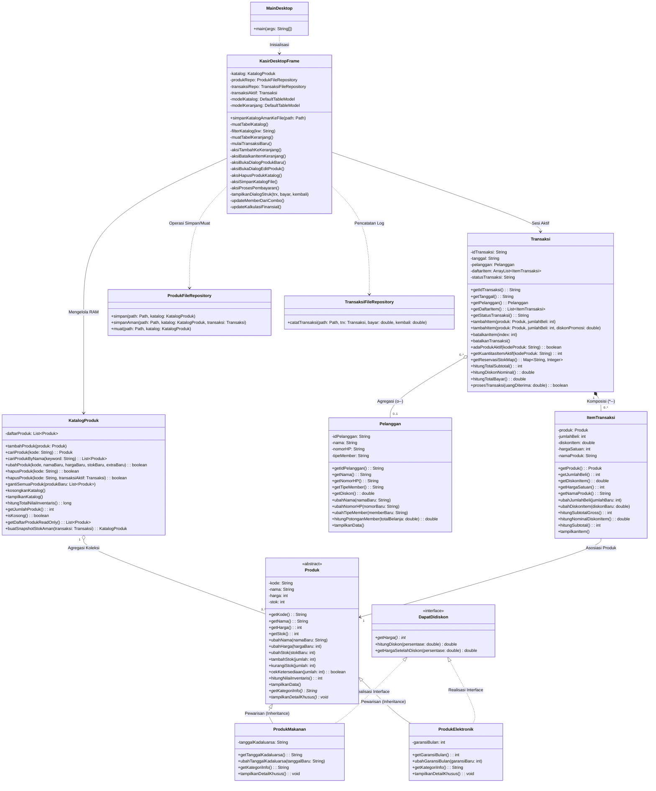
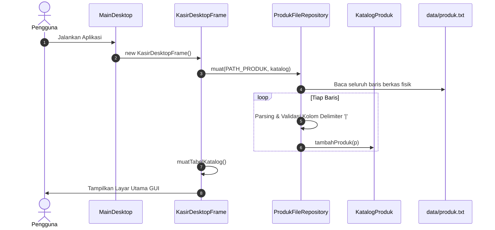
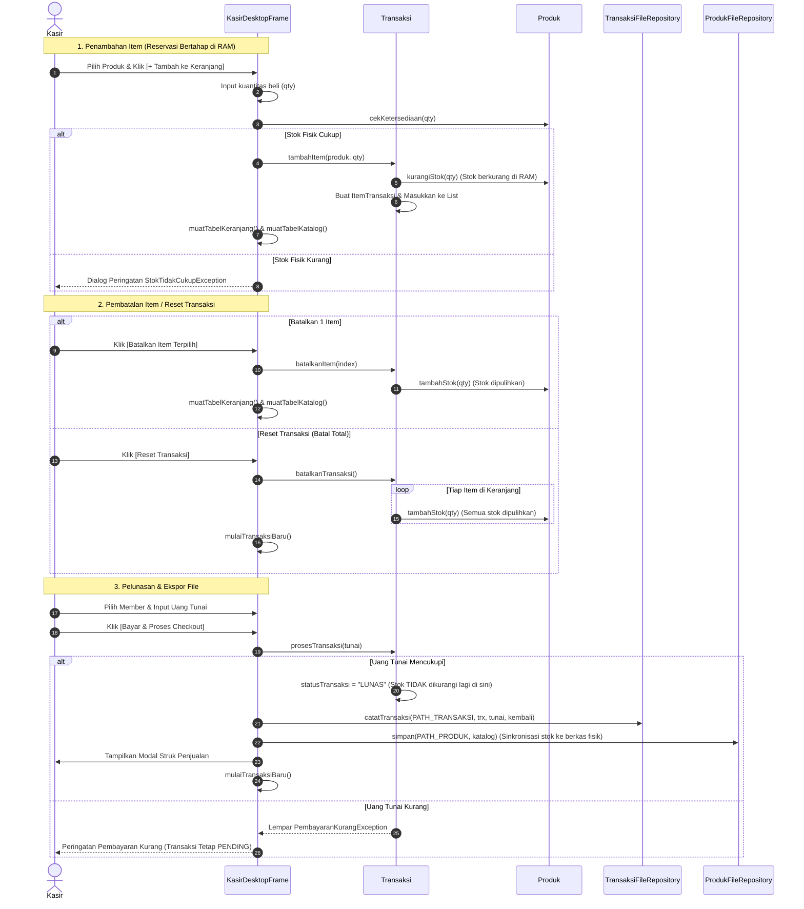

# DOKUMEN OVERVIEW & ANALISIS ARSITEKTUR SISTEM
# SISTEM KASIR SEDERHANA (POINT OF SALE - DESKTOP VERSION)

**Mata Kuliah**    : Praktikum Pemrograman Berorientasi Obyek (PBO)  
**Mahasiswa**      : Rafael Rizky Luga Tanjung (NRP: 3125522007)  
**Dosen Pengampu** : Nirwana Haidar Hari, S.Pd., M.Kom.  
**Program Studi**  : D3/D4 Teknik Informatika - PENS PSDKU Sumenep (2026)  
**Lokasi Direktori**: `P15 POS System Desktop Version 3125522007_Rafael_Rizky/SourceCode`  

---

## 1. Mengenal Sistem: Ini Sistem Apa?

Aplikasi ini adalah **Sistem Kasir Penjualan Retail (Point of Sale / POS System) Berbasis Desktop GUI**. Sistem ini dirancang untuk mendigitalkan dan mengotomatiskan aktivitas kasir toko modern, mencakup:
1. **Pengelolaan Katalog Produk**: Registrasi komoditas majemuk, pembaruan atribut, dan penghapusan data inventaris.
2. **Pencarian Cepat (*Live Filter*)**: Penyaringan barang secara instan berdasarkan kode unik atau kata kunci nama barang.
3. **Pencatatan Transaksi Penjualan**: Keranjang belanja interaktif dengan kalkulasi otomatis subtotal kotor, diskon barang, dan diskon keanggotaan pelanggan.
4. **Validasi & Penegakan Aturan Bisnis (*Fail-Fast*)**: Penolakan otomatis atas kondisi transaksi abnormal (stok habis, pembayaran kurang, nota kosong) menggunakan eksepsi terstruktur.
5. **Pencetakan Struk Digital**: Penampil nota transaksi kasir berformat *monospaced receipt*.
6. **Persistensi Berkas Fisik (*Flat-File Database*)**: Penyimpanan lokal tanpa ketergantungan DBMS eksternal (*zero external dependency*).

Sistem ini merupakan **kulminasi proyek terintegrasi dari Modul 1 hingga Modul 15** yang mendemonstrasikan implementasi pilar-pilar OOP (*Encapsulation, Inheritance, Polymorphism, Abstraction*), manajemen koleksi memori, penanganan eksepsi, *file I/O*, serta perancangan GUI berbasis *event-driven programming* dengan Java Swing.

---

## 2. Struktur Direktori & Pemetaan Berkas

```
SourceCode/
├── MainDesktop.java                   <-- Bootstrap / Entry Point Peluncur Aplikasi GUI
├── view/
│   └── KasirDesktopFrame.java         <-- Lapisan Presentasi (Java Swing GUI & Event Controller)
├── model/
│   ├── Produk.java                    <-- Abstract Superclass Domain Komoditas
│   ├── ProdukMakanan.java             <-- Subclass Komoditas Konsumsi (Info Exp)
│   ├── ProdukElektronik.java          <-- Subclass Komoditas Hardware (Info Garansi)
│   ├── DapatDidiskon.java             <-- Interface Kontrak Diskon Promosi Item
│   ├── Pelanggan.java                 <-- Entity Data Konsumen & Skema Diskon Member
│   ├── ItemTransaksi.java             <-- Komposisi Baris Belanjaan (Produk, Qty, Diskon)
│   ├── Transaksi.java                 <-- Aggregate Root Nota Transaksi & Pelunasan
│   ├── KatalogProduk.java             <-- Collection Manager In-Memory (List<Produk>)
│   ├── ProdukFileRepository.java      <-- I/O Persistence Data Katalog (data/produk.txt)
│   ├── TransaksiFileRepository.java   <-- I/O Persistence Log Audit Nota (data/transaksi.txt)
│   └── exception/
│       ├── KasirException.java        <-- Superclass Checked Exception Domain Kasir
│       ├── StokTidakCukupException.java          <-- Ditolak jika qty > stok fisik
│       ├── PembayaranKurangException.java        <-- Ditolak jika uang tunai < tagihan
│       ├── TransaksiKosongException.java         <-- Ditolak jika checkout nota kosong
│       └── StatusTransaksiInvalidException.java  <-- Ditolak jika nota LUNAS/BATAL dimutasi
└── data/
    ├── produk.txt                     <-- Basis Data Fisik Berkas Teks Katalog Barang
    └── transaksi.txt                  <-- Basis Data Fisik Berkas Teks Log Transaksi
```

---

## 3. Diagram Arsitektur Kelas (UML Class Diagram)

Diagram berikut merefleksikan seluruh method dan relasi objek **sesuai dengan implementasi kode aktual**:



---

## 4. Hirarki Custom Exception & Penegakan Aturan Bisnis

Sistem tidak mengandalkan *silent failure*. Seluruh pelanggaran invariant melempar eksepsi terstruktur:

```
java.lang.Exception
   └── model.exception.KasirException (Checked Exception)
           ├── StokTidakCukupException
           ├── PembayaranKurangException
           ├── TransaksiKosongException
           ├── StatusTransaksiInvalidException
           └── ProdukSedangDigunakanException
```

1. **`StokTidakCukupException`**:
   - **Pemicu**: Kasir memasukkan kuantitas belanja yang melebihi stok fisik produk (`jumlahBeli > produk.getStok()`).
   - **Tindakan**: Penambahan ke keranjang ditolak seketika; sisa stok fisik di katalog tetap utuh.
2. **`PembayaranKurangException`**:
   - **Pemicu**: Nominal uang tunai konsumen lebih kecil dari total tagihan akhir setelah diskon (`uangDiterima < hitungTotalBayar()`).
   - **Tindakan**: Status nota tetap `"PENDING"` dan proses pelunasan dihentikan.
3. **`TransaksiKosongException`**:
   - **Pemicu**: Kasir menekan tombol bayar padahal keranjang belanja belum memiliki item (`daftarItem.isEmpty()`).
   - **Tindakan**: Pelunasan dibatalkan sebelum memanipulasi berkas.
4. **`StatusTransaksiInvalidException`**:
   - **Pemicu**: Mutasi state (seperti memanggil `tambahItem()`, `batalkanItem()`, atau `batalkanTransaksi()`) dilakukan pada objek nota yang statusnya sudah final (`"LUNAS"` atau `"DIBATALKAN"`), atau pencatatan transaksi non-LUNAS ke disk.
   - **Tindakan**: Menjamin kekekalan (*immutability*) nota transaksi yang sudah selesai.
5. **`ProdukSedangDigunakanException`**:
   - **Pemicu**: Kasir/Admin mencoba menghapus produk dari katalog ketika produk tersebut sedang tereservasi di dalam keranjang transaksi belanja aktif (`PENDING`).
   - **Tindakan**: Menjamin integritas referensial dan mencegah kehilangan data produk di tengah transaksi berjalan.

---

## 5. Alur Kerja Sistem (Sequence Diagram)

### A. Alur Inisialisasi Aplikasi (Startup & Safe Load)


---

### B. Alur Transaksi Kasir, Reservasi Stok & Pelunasan Aktual


---

## 6. Format Penyimpanan Data Berkas Fisik

Sistem memanfaatkan berkas teks berekstensi `.txt` dengan karakter pemisah *pipe* (`|`):

### A. Berkas `data/produk.txt`
Struktur Kolom: `KODE|NAMA|HARGA|STOK|KATEGORI|INFO_KHUSUS`
Contoh baris data:
```text
MK01|Roti Gandum Sehat|18000|25|Makanan|2026-12-31
EL01|Mouse Wireless Ergonomis|150000|15|Elektronik|12
```

### B. Berkas `data/transaksi.txt`
Struktur Kolom: `ID_TRANSAKSI|TANGGAL|NAMA_PELANGGAN|TIPE_MEMBER|TOTAL_BAYAR|TUNAI|KEMBALIAN|STATUS`
Contoh baris data terhitung presisi:
```text
TRX-1794207600000|09-11-2026 14:00|Rafael Rizky|VIP|121125|150000|28875|LUNAS
```

> **Verifikasi Matematis & Stempel Waktu (WIB / UTC+7)**:
> - **ID Transaksi**: `TRX-1794207600000`
> - **Epoch Milliseconds**: `1794207600000L`
> - **Konversi `java.time` (ZoneId `Asia/Jakarta`)**: `Instant.ofEpochMilli(1794207600000L).atZone(ZoneId.of("Asia/Jakarta"))` menghasilkan tepat tanggal **`09-11-2026 14:00`**.
> - **Kalkulasi Finansial**:
>   - Subtotal Kotor = Rp 142.500
>   - Diskon Member VIP (15%) = Rp 21.375
>   - Total Akhir = Rp 121.125
>   - Uang Tunai = Rp 150.000
>   - Kembalian = Rp 28.875 (Status: `LUNAS`)

---

## 7. Status Implementasi & Evaluasi Kritis Arsitektur

### A. Fitur yang SUDAH Diimplementasikan & Teruji (Disertai Bukti Suite Pengujian)
1. **CRUD Katalog In-Memory**: Tambah, Cari (kode & nama), Edit (dialog modal pre-filled), dan Hapus produk.
2. **Order Line Immutability (Snapshot Harga Keranjang)**: Setiap `ItemTransaksi` merekam `hargaSatuan` saat dimasukkan ke keranjang belanja. Jika harga produk di katalog diubah di kemudian hari, subtotal transaksi keranjang yang sedang berjalan tidak berubah (teruji di `TestOrderLineImmutability`).
3. **Atomic Pre-Validation pada `ubahProduk`**: Validasi seluruh parameter (nama, harga, stok, info khusus) tuntas sebelum setter pertama dieksekusi, mencegah korupsi mutasi parsial pada state objek produk lama (teruji di `TestInvarianceUbahProduk`).
4. **Proteksi Integritas Stok di Keranjang Aktif**:
   - Kolom stok pada modal edit katalog otomatis dikunci (`editable = false`) jika produk sedang berada di keranjang transaksi aktif (`PENDING`).
   - Tombol hapus katalog menolak menghapus produk yang sedang berada di keranjang aktif (teruji di `TestEditStokKeranjang`).
5. **Pencegahan Kebocoran Stok Fisik ke File (`simpanKatalogAmanKeFile`)**: Method penyimpanan katalog menghitung stok nyata (`stok RAM + kuantitas tereservasi keranjang PENDING`), sehingga jika berkas `produk.txt` disimpan saat transaksi belum lunas, stok fisik di berkas disk tidak berkurang prematur. Selain itu, event `windowClosing` meminta konfirmasi dan memulihkan stok jika kasir menutup jendela saat transaksi pending (teruji di `TestStokTereservasiSimpanFile`).
6. **Pemulihan Stok pada Pembatalan Transaksi**: Pemanggilan `batalkanTransaksi()` atau `batalkanItem()` memulihkan kuantitas belanja kembali ke stok produk di katalog (teruji di `TestAlurStokResetTransaksi`).
7. **Kalkulasi Diskon Bertingkat**: Diskon promosi per item dan diskon member (VIP 15%, GOLD 10%, REGULER 0%).
8. **Eksepsi Fail-Fast & Validasi Berlapis**: Mengeliminasi silent failure lewat hirarki `KasirException` (`StokTidakCukupException`, `PembayaranKurangException`, `TransaksiKosongException`, `StatusTransaksiInvalidException`).

### B. Batasan Sistem & Rencana Pengembangan Masa Depan
1. **Model Reservasi Stok**:
   - *Batasan Saat Ini*: Stok berkurang seketika di RAM saat masuk keranjang (*incremental reservation*). Jika listrik padam atau aplikasi di-*force-kill* saat transaksi PENDING belum di-checkout, reservasi stok di RAM hilang dan saat dibuka kembali stok kembali ke nilai file `produk.txt`.
   - *Rencana Pengembangan*: Menambahkan *Write-Ahead Log (WAL)* sementara di disk untuk transaksi PENDING.
2. **Ketahanan Tulis Berkas (*Crash-Safe Atomic Write*)**:
   - *Batasan Saat Ini*: `ProdukFileRepository.simpan()` menulis langsung ke berkas target. Jika sistem mati mendadak di tengah proses tulis, file berpotensi terpotong.
   - *Rencana Pengembangan*: Menerapkan teknik *Write-to-Temp and Atomic Rename* menggunakan `Files.move(tempFile, targetFile, StandardCopyOption.ATOMIC_MOVE)`.
3. **Konsistensi Penulisan Ganda (*Dual-Write Consistency*)**:
   - *Batasan Saat Ini*: Penulisan ke `transaksi.txt` dan `produk.txt` dilakukan berurutan tanpa *Two-Phase Commit (2PC)*. Kegagalan pada langkah kedua dapat menyebabkan desinkronisasi antara riwayat nota dan sisa stok.
   - *Rencana Pengembangan*: Menggunakan direktori jurnal transaksi terpadu atau migrasi ke mesin basis data ACID *embedded* (seperti SQLite/H2).
4. **Tipe Data Keuangan & Type Safety**:
   - *Batasan Saat Ini*: Subtotal menggunakan `double` (risiko *floating-point rounding error*). Tipe member dan status transaksi berupa `String`.
   - *Rencana Pengembangan*: Mengonversi perhitungan uang ke `BigDecimal` / `long`, serta menerapkan `enum TipeMember` dan `enum StatusTransaksi` untuk menjamin *compile-time safety*.
5. **Pola Desain Arsitektur**:
   - *Batasan Saat Ini*: `KasirDesktopFrame` mengimplementasikan pola *Autonomous View / Smart UI*, merangkap peran View dan Controller.
   - *Rencana Pengembangan*: Merefaktor arsitektur menjadi **Model-View-Presenter (MVP)** murni.

---

## 8. Panduan Menjalankan Sistem & Suite Pengujian

### A. Menjalankan Seluruh Suite Pengujian Otomatis (Regresi & Invariansi):
```powershell
cd "D:\Rizky\PBO\P15 POS System Desktop Version 3125522007_Rafael_Rizky\SourceCode"; javac -cp . test/*.java; java -cp . test.RunAllTests
```

### B. Menjalankan Aplikasi Kasir Desktop GUI (PowerShell 1 Baris):
```powershell
cd "D:\Rizky\PBO\P15 POS System Desktop Version 3125522007_Rafael_Rizky\SourceCode"; javac -cp . MainDesktop.java view/*.java model/*.java model/exception/*.java; java -cp . MainDesktop
```

### C. Menjalankan Langsung via VS Code:
1. Buka berkas [`MainDesktop.java`](file:///D:/Rizky/PBO/P15%20POS%20System%20Desktop%20Version%203125522007_Rafael_Rizky/SourceCode/MainDesktop.java).
2. Tekan tombol **Play (Run Java)** ▶️ di pojok kanan atas jendela editor atau gunakan shortcut **`F5`** / **`Ctrl + F5`**.
